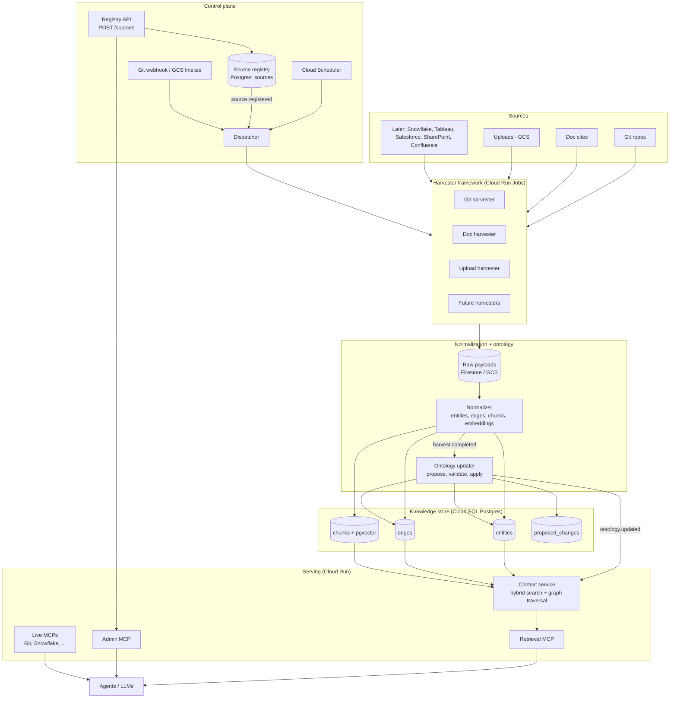

# Architecture: topology and hierarchy

End goal: expose the platform as MCP servers so agents and LLMs can discover, query and (with limits) manage enterprise context. This page shows the layers, the data hierarchy and the MCP surface. Contracts (schema, ontology, harvester interface) live in `CLAUDE.md` and the Confluence Contracts page.

## 1. System topology



### Layers and responsibilities

| Layer | Component | GCP service | Responsibility |
|---|---|---|---|
| 0 Sources | Git, docs, uploads | n/a | Systems of record; never modified |
| 1 Control plane | Registry API, dispatcher, scheduler, webhooks | Cloud Run, Scheduler, Pub/Sub | Decide what to harvest and when |
| 2 Harvest | One harvester per source type | Cloud Run Jobs | discover, fetch, emit raw objects incrementally |
| 3 Normalize | Normalizer | Cloud Run Job | Raw to entities, edges, chunks, embeddings |
| 4 Ontology | Updater | Cloud Run Job | Apply deterministic facts, queue uncertain ones |
| 5 Store | entities, edges, chunks, proposed_changes | Cloud SQL + pgvector | Single source of truth for knowledge |
| 6 Serve | Context service | Cloud Run | Hybrid search, graph traversal, ACL filtering |
| 7 Interface | MCP servers | Cloud Run | The contract agents use |

## 2. Data hierarchy

### 2.1 Entity containment (what lives inside what)

```
Source (registry row)
└── Repository / Document site / Upload set
    ├── Module / Service
    │   ├── Job (ETL, pipeline)
    │   │   ├── READS_FROM  -> Table
    │   │   └── WRITES_TO   -> Table
    │   └── Document (README, design doc)
    │       └── Chunk (embedding + citation)
    ├── Table
    │   └── Column
    │       └── DERIVED_FROM -> Column  (lineage)
    ├── Dashboard
    │   └── READS_FROM -> Table
    └── Person / Team
        └── OWNED_BY (from Repository, Module, Table, Dashboard)
```

### 2.2 Ontology layers

| Layer | Contents | Changes |
|---|---|---|
| Core ontology (versioned file) | Entity and relation types | Rarely, via reviewed PR; bumps `ontology_version` |
| Facts | entities and edges with `source_id`, `confidence`, `ontology_version` | Every harvest |
| Proposals | `proposed_changes`: new types, low-confidence facts, entity merges | Queue, auto-apply only above threshold for known types |
| Chunks | Text spans with embeddings, linked to an entity | Every harvest; re-embedded when `embedding_model` changes |

### 2.3 Retrieval hierarchy (how a query is answered)

```
Agent question
└── Context service
    ├── 1. Filter: sensitivity / source / type / not tombstoned
    ├── 2. Candidate search: keyword + vector (chunks)
    ├── 3. Graph expansion: edges from matched entities (depth-limited)
    ├── 4. Rerank + token budget
    └── 5. Response: results + citations (source link, harvested_at, sensitivity)
```

## 3. MCP topology

Each MCP server is a thin, stateless Cloud Run service over the context service. Transport: streamable HTTP. All tool results include citations and freshness.

```
Agent / LLM (MCP client)
├── context-retrieval  (read-only, default for all agents)
│   ├── tools
│   │   ├── search_context(query, filters?, limit?)
│   │   ├── get_entity(id | external_id)
│   │   ├── get_related(entity, relation?, depth?, direction?)
│   │   ├── get_lineage(entity, direction=upstream|downstream, depth?)
│   │   ├── list_sources(type?, status?)
│   │   └── get_source_status(source_id)        # last_harvest_at, errors, freshness
│   ├── resources
│   │   ├── ontology://v{n}                      # entity and relation types
│   │   └── entity://{id}                        # entity card with edges
│   └── prompts
│       └── explain_asset, impact_analysis, find_owner
│
├── context-admin  (write, restricted, audit-logged)
│   ├── register_source(type, uri, schedule, credentials_ref, owner, sensitivity)
│   ├── update_source(id, schedule?, status?)
│   ├── trigger_harvest(source_id)
│   └── review_proposal(id, approve|reject)
│
└── live MCPs  (fallback when indexed context is stale or missing)
    ├── git       (read file, blame, log)
    └── snowflake (describe table, sample rows; read-only role)
```

### MCP design rules
- **Retrieval first, live second.** The context service answers from the index. Agents call live MCPs only when `get_source_status` shows stale data or the item is not indexed; label results as `indexed` or `live`.
- **Small, well-described tool surface.** Each tool does one thing; descriptions say when to use it.
- **Always return provenance:** `source_url`, `harvested_at`, `sensitivity`, `confidence` where relevant.
- **Token budgets:** results are truncated or paginated; include `next_cursor`.
- **Separate servers by risk.** Read tools and write tools are different servers so permissions can differ per agent.
- **Identity and permissions:** each call carries a caller identity; the context service filters by `sensitivity` and source access. Every call is audit-logged (caller, query, returned source IDs).
- **No secrets through MCP.** `credentials_ref` is never returned; live MCPs use their own service accounts.

### Example agent flow
```
User: "What breaks if we change table CUSTOMER?"
 1. search_context("CUSTOMER table")            -> entity Table:CUSTOMER
 2. get_lineage(Table:CUSTOMER, downstream, 3)  -> Jobs, Tables, Dashboards
 3. get_related(each Dashboard, OWNED_BY)       -> owners
 4. get_source_status(source of CUSTOMER)       -> fresh within SLA? else live MCP check
 5. Answer with cited assets, owners and freshness
```

## 4. Build mapping (Jira epics)

| Epic | Delivers |
|---|---|
| 1 Foundation | GCP project, Cloud SQL, schema, CI |
| 2 Source registry and API | Control plane, `source.registered` |
| 3 Git harvester | First harvester, entities and chunks |
| 4 Scheduler and incremental | Dispatcher, idempotent upserts, tombstones |
| 5 Ontology updater | Deterministic and LLM extraction, proposals |
| 6 Retrieval MCP and context service | `context-retrieval` server |
| 7 Upload harvester | GCS-driven ingestion |
| 8 Demo, evals, docs | Golden questions, demo, docs |

Suggested additions (not yet in Jira): a `context-admin` MCP story under Epic 2 or 6, and MCP auth/audit under Epic 6.

## 5. Evolution path
1. Hackathon: Postgres + pgvector for relationships; one retrieval MCP; Git and upload harvesters.
2. Next: Snowflake/Confluence/Tableau harvesters, live MCP fallback, review queue UI.
3. Scale: dedicated graph store only if traversal depth or latency requires it; AlloyDB for vectors at volume; per-user ACL propagation from source systems.


